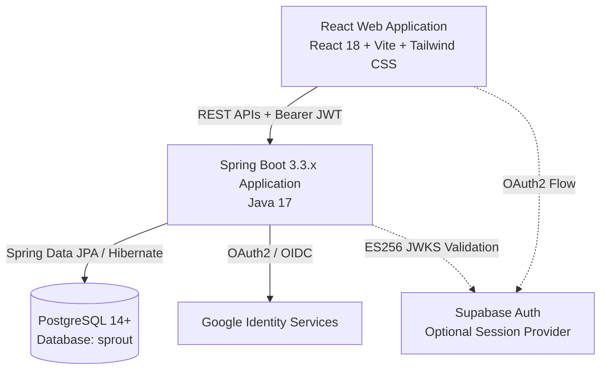
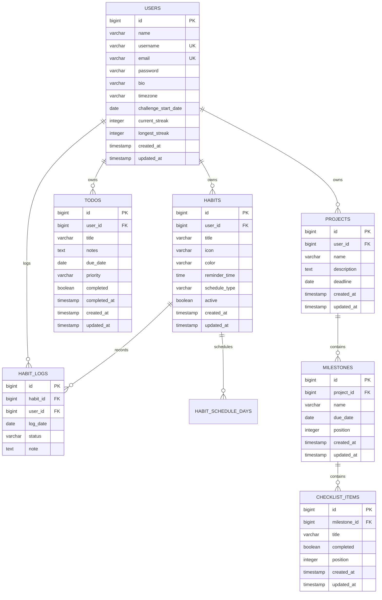

# Ascend (Sprout) — Existing Architecture Audit

> **System Overview:** Ascend (internally referred to as Sprout) is a full-stack habit tracking and personal productivity platform designed around a structured challenge cycle (default 75 days). It combines daily recurring habits, ad-hoc task management, multi-stage project milestones, daily journaling, and productivity analytics into a unified system.

---

## 1. High-Level Technology Stack



| Layer | Technology | Version / Key Libraries | Role in Application |
|---|---|---|---|
| **Frontend** | React | `18.3.1` (Vite `5.4.1`) | Single-page application, client routing, UI state |
| **Styling** | Tailwind CSS + CSS Variables | Tailwind `3.4.10`, Lucide Icons `0.435.0` | Themeable design system (Light, Dark, Paper, Forest, etc.) |
| **HTTP Client** | Axios | `1.7.5` | Centralized API client with JWT interceptors |
| **Backend** | Spring Boot | `3.3.x` on Java `17` | RESTful API, business logic, security filter chain |
| **Security** | Spring Security | `6.x` + JJWT `0.12.5` | Stateless JWT authentication, Google OAuth2 client |
| **Persistence**| Spring Data JPA | Hibernate ORM | Relational mapping, schema generation (`ddl-auto: update`) |
| **Database** | PostgreSQL | `14+` | Primary relational data store |

---

## 2. Backend Architecture Audit

### 2.1 Package & Layer Structure

The backend source code is located at `sprout/backend/src/main/java/com/sprout/backend/` and follows a strict clean-layered architecture:

```
com.sprout.backend/
├── config/             # SecurityConfig, DataSeeder, WebMvc/CORS
├── controller/         # REST Controllers exposing JSON endpoints
├── dto/
│   ├── request/        # Immutable Java Records for incoming request validation
│   └── response/       # Immutable Java Records for API responses
├── entity/             # JPA Entities mapped to PostgreSQL tables
├── exception/          # ApiException, GlobalExceptionHandler, ErrorResponse
├── repository/         # Spring Data JPA Repositories (Derived & JPQL queries)
├── security/           # JwtService, JwtAuthenticationFilter, UserPrincipal, OAuth handlers
├── service/            # Core business logic and transaction boundaries
└── util/               # Date/time calculations (ChallengeDayCalculator)
```

### 2.2 Security & Authentication Infrastructure

The application uses **stateless Bearer JWT** authentication with Spring Security:

1. **JWT Issuance & Verification (`JwtService.java`)**:
   - Algorithms: HMAC-SHA256 (`io.jsonwebtoken.security.Keys.hmacShaKeyFor`).
   - Secret key: Configured via `sprout.jwt.secret` (`JWT_SECRET` environment variable, 32+ characters).
   - Lifetime: 24 hours (`JWT_EXPIRATION_MS`, default `86,400,000 ms`).
   - Claims: Subject is the user's `username`. Extracted and converted to `UserPrincipal`.
   - **No Refresh Tokens**: The system is designed for simple 24-hour bearer tokens. When expired, the user must re-authenticate.

2. **Filter Chain (`SecurityConfig.java`)**:
   - `sessionCreationPolicy(SessionCreationPolicy.IF_REQUIRED)`.
   - `csrf().disable()` (stateless API).
   - Public paths: `/api/auth/**`, `/oauth2/**`, `/login/oauth2/**`, `/actuator/health`.
   - Protected paths: `/api/**` requires valid JWT token via `JwtAuthenticationFilter`.
   - Authentication Entry Point returns structured JSON `{"message": "Authentication required"}` with HTTP 401.

3. **Existing Google OAuth2 Flow**:
   - Configured in `application.yml` under `spring.security.oauth2.client.registration.google`.
   - Initiated at `/oauth2/authorization/google`.
   - Google returns authorization code to `/login/oauth2/code/google`.
   - `OAuth2AuthenticationSuccessHandler.java` intercepts the authenticated principal, extracts `email` and `name`, invokes `GoogleOAuth2Service.findOrCreateUser(email, name)`, and generates an Ascend JWT.
   - Redirects the browser to `${sprout.oauth2.frontend-redirect-uri}?token=<JWT>&created=<boolean>`.

4. **Existing Supabase OAuth Bridge (`AuthController.java`)**:
   - Route: `POST /api/auth/register-oauth` (or `/api/auth/supabase`).
   - Accepts a Supabase JWT in `Authorization: Bearer <token>`.
   - Decodes and validates token using JWKS ES256 decoder against `${sprout.supabase.url}/auth/v1/.well-known/jwks.json`.
   - Extracts email and metadata (`name`, `username`), calls `AuthService.registerOAuth()`, and issues an Ascend JWT.

5. **CORS Configuration**:
   - Controlled by `${sprout.cors.allowed-origin:http://localhost:5173}`.
   - Allowed methods: `GET, POST, PUT, PATCH, DELETE, OPTIONS`.
   - Allowed headers: `*`.
   - `allowCredentials: true`.
   - **Note for Extension**: Chrome extensions run under origin `chrome-extension://<extension-id>`. This will require CORS policy consideration.

---

## 3. Database Schema & Data Models

The PostgreSQL database maintains the following primary entities:



### 3.1 Entity Details & Constraints

1. **`users`**:
   - `id`: Auto-incrementing primary key.
   - `email`, `username`: Unique indexed strings.
   - `current_streak`, `longest_streak`: User progress counters.

2. **`habits`**:
   - Soft-delete pattern: Deleting a habit sets `active = false` so historical completion data is preserved.
   - `schedule_type`: `EVERY_DAY` or `SPECIFIC_DAYS`.
   - `habit_schedule_days`: Child collection storing `MONDAY`, `TUESDAY`, etc.

3. **`habit_logs`**:
   - Unique constraint on `(habit_id, log_date)`.
   - **One log per habit per calendar day**: When marking a habit, an upsert is performed.
   - Status values: `PENDING` (implicit if no log exists), `COMPLETED`, `MISSED`, `SKIPPED`.

4. **`todos`**:
   - Independent tasks (distinct from recurring habits).
   - Priority: `LOW`, `MEDIUM`, `HIGH`.
   - `dueDate`: Optional ISO date (`YYYY-MM-DD`).
   - `completed`: Boolean toggle, tracks `completed_at` timestamp.
   - `todo_tags`: Ordered tag list.

5. **`projects`**:
   - High-level containers with `name`, `description`, `deadline`.
   - **Progress calculation**: Dynamically computed as the average completion percentage of all child milestones (`0-100%`).

6. **`milestones`**:
   - Ordered stages within a project (`position`).
   - Contains an ordered checklist of items.
   - **Progress calculation**: Computed as `(completed_checklist_items / total_checklist_items) * 100`.

7. **`checklist_items`**:
   - Granular toggleable items (`completed: boolean`).

---

## 4. Frontend Architecture Audit

### 4.1 Technology & Structure

- Located at `sprout/frontend/`.
- Single Page Application with React 18, React Router v6, Tailwind CSS.
- Main entry point: `main.jsx` -> `App.jsx`.
- Contexts:
  - `AuthContext.jsx`: Holds current `user`, `loading`, provides `login`, `googleLogin`, `logout`, handles token storage in `localStorage`.
  - `ThemeContext.jsx`: Manages theme mode (`paper`, `dark`, `default`/`light`, `system`), sets `.dark` or `.paper` classes on document root.
- API Client (`api/axios.js`):
  - Pre-configured Axios instance with `baseURL: import.meta.env.VITE_API_URL || "http://localhost:8080/api"`.
  - Request interceptor automatically attaches `Authorization: Bearer <sprout_token>`.
  - Response interceptor redirects to `/login` on 401 HTTP response.

### 4.2 UI Design System & Color Tokens

From `sprout/frontend/src/index.css` and `sprout/frontend/src/styles/home.css`:

```css
/* Light / Paper / Blush Mode */
:root {
  --bg:         #f5f0e8;
  --surface:    #fffdf7;
  --surface-2:  #edeae0;
  --surface-3:  #e4dfd4;
  --border:     #d8d0c0;
  --text:       #2a2218;
  --text-muted: #9a9080;
  --accent:     #c05a20;  /* or #d95a2b */
  --accent-fg:  #fff8ef;
  --green:      #437830;
  --red:        #b03050;
  --blue:       #2848a8;
  --ring:       rgba(192,90,32,.3);
}

/* Dark Mode */
.dark {
  --bg:         #241b29;
  --surface:    #332638;
  --surface-2:  #3d2e44;
  --surface-3:  #473650;
  --border:     #4a3a52;
  --text:       #f6ecf4;
  --text-muted: #c0a9c2;
  --accent:     #e07fc0;
  --accent-fg:  #1e0f1e;
  --green:      #7ec99a;
  --red:        #f07090;
  --blue:       #80a4f0;
  --ring:       rgba(224,127,192,.3);
}
```

Typography:
- Primary Display: `"Fraunces", serif` and `"Baloo 2", sans-serif`.
- Body: `"Nunito", system-ui, sans-serif` and `'DM Sans', sans-serif`.

---

## 5. Strengths & Architectural Boundaries for Extension Development

1. **Pure Single Source of Truth**: The existing Spring Boot backend already contains all business logic, validation, streak calculation, and persistence. The extension needs zero custom server-side data stores.
2. **Unified REST Surface**: Endpoints like `/api/days/today` and `/api/todos/today` aggregate all data needed for today's view in single network requests.
3. **Soft Deletes & Daily Upserts**: Habits are soft-deleted and habit logs are strictly upserted per day, protecting historical integrity across clients.
4. **Clean Boundary**: The extension will act strictly as an independent presentation layer communicating over standard REST + JWT.
