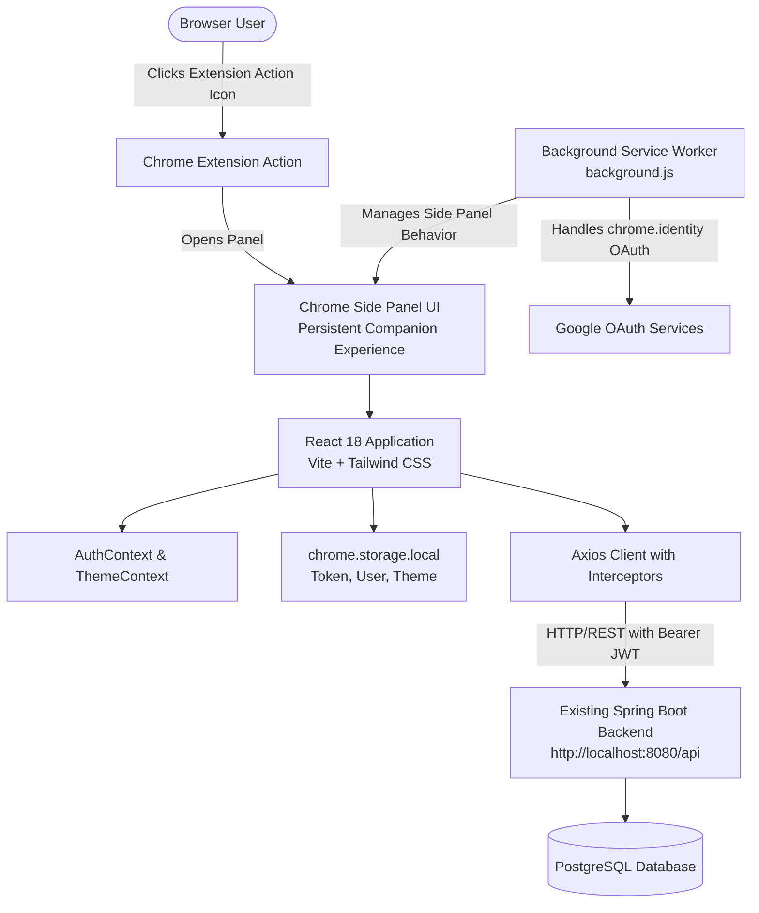
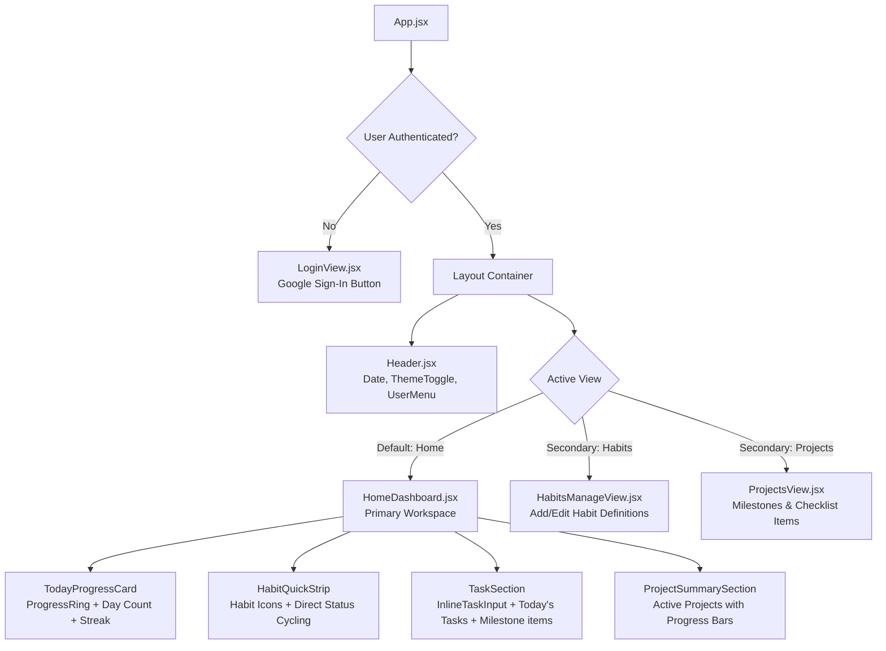

# Ascend Chrome Extension — Extension Architecture Specification

> **Mission:** Build a high-performance, distraction-free Chrome Extension that brings the core productivity mechanics of Ascend (habits, tasks, projects & milestones) directly into the user's daily browser workflow.

---

## 1. Extension Manifest & Platform Architecture

The extension is architected on **Chrome Extension Manifest V3 (MV3)**, leveraging the modern Chrome Extension APIs:



### 1.1 UI Surface Decision: Side Panel vs. Popup

After evaluating usability and development complexity against the requirement for an all-in-one productivity companion:

- **Primary Interface: Chrome Side Panel (`chrome.sidePanel`)**
  - **Why Side Panel Wins:**
    1. **Persistent State:** Unlike popups (which abruptly close and lose in-progress task typing when clicking anywhere in the browser), the Side Panel remains open alongside the user's tabs while they research, work, or browse.
    2. **Ergonomic Workspace:** Offers a comfortable width (380px–420px) and full browser viewport height, accommodating today's progress ring, habit status toggles, inline task input, task list, and milestone cards without cramped claustrophobia.
    3. **Zero Context Switching:** Users can glance at today's tasks and check off items while writing emails, reviewing code, or reading articles.
  - **Configuration:** Set `openPanelOnActionClick: true` via `chrome.sidePanel.setPanelBehavior()` so clicking the extension toolbar icon opens the Side Panel directly.
  - **Popup Evaluation:** Having both a popup and a side panel with identical features creates maintenance duplication. However, we structure the Vite build so the single React application root can render in either a Side Panel (`sidepanel.html`) or a Popup (`popup.html`) with zero code duplication if a popup trigger is ever desired.

---

## 2. Recommended Directory & Component Structure

```
Chrome-Extension-Ascend/
├── public/
│   ├── manifest.json              # Manifest V3 configuration
│   └── icons/                     # 16, 32, 48, 128px PNG extension icons
├── src/
│   ├── api/
│   │   ├── client.js              # Axios instance configured with JWT & chrome.storage.local
│   │   ├── auth.js                # Google login API calls & session validation
│   │   ├── days.js                # /api/days/today endpoints
│   │   ├── habits.js              # Habit CRUD & /api/habits/{id}/logs
│   │   ├── todos.js               # Task CRUD & /api/todos/quick & checklist toggles
│   │   └── projects.js            # Project & milestone listing/mutations
│   ├── background/
│   │   └── service-worker.js      # Side panel setup & auth message listeners
│   ├── components/
│   │   ├── common/
│   │   │   ├── Button.jsx         # Accessible buttons (primary, secondary, danger)
│   │   │   ├── ProgressRing.jsx   # SVG completion ring adapted from existing UI
│   │   │   ├── ProgressBar.jsx    # Linear progress bar for projects/milestones
│   │   │   ├── StatusPill.jsx     # Consistent status badge (DONE, GO, SKIP, MISS)
│   │   │   ├── PriorityBadge.jsx  # High / Med / Low priority pill
│   │   │   ├── EmptyState.jsx     # Clean empty placeholders with actions
│   │   │   └── Modal.jsx          # Lightweight portal/inline dialog
│   │   ├── layout/
│   │   │   ├── Header.jsx         # Compact top bar (Logo, Date, ThemeToggle, UserMenu)
│   │   │   ├── ThemeToggle.jsx    # Light / Dark switcher
│   │   │   └── UserMenu.jsx       # Avatar, name, streak badge, and Sign Out
│   │   ├── dashboard/
│   │   │   ├── TodayProgressCard.jsx # Today summary: progress ring, streak, day badge
│   │   │   ├── HabitQuickStrip.jsx   # Direct 1-click habit status cycler
│   │   │   ├── TaskSection.jsx       # Inline task creation & task list container
│   │   │   ├── InlineTaskInput.jsx   # Fast keyboard-friendly inline task creator
│   │   │   ├── TaskRow.jsx           # Individual task row with checkbox, priority, edit/delete
│   │   │   └── ProjectSummaryRow.jsx # Active project cards with milestone progress
│   │   ├── habits/
│   │   │   ├── HabitModal.jsx        # Create/edit habit modal (title, icon, color, schedule)
│   │   │   └── HabitManageList.jsx   # Secondary view for full habit management
│   │   └── projects/
│   │       ├── ProjectDetailModal.jsx# Secondary view for inspecting milestones & checklist items
│   │       ├── MilestoneCard.jsx     # Milestone container with child checklist items
│   │       └── ChecklistItemRow.jsx  # Toggleable checklist item
│   ├── context/
│   │   ├── AuthContext.jsx        # Google OAuth state, user, token via chrome.storage.local
│   │   └── ThemeContext.jsx       # Light / Dark / System theme state & HTML class injection
│   ├── hooks/
│   │   ├── useToday.js            # SWR-style hook for today's summary & habits
│   │   ├── useTasks.js            # Hook for today's tasks + filter states
│   │   └── useProjects.js         # Hook for active projects
│   ├── lib/
│   │   ├── habitIcons.js          # Lucide icon mapping matching existing Ascend icons
│   │   └── storage.js             # Type-safe wrapper for chrome.storage.local
│   ├── pages/
│   │   ├── HomeDashboard.jsx      # Primary single-screen workspace
│   │   ├── HabitsManageView.jsx   # Secondary view: manage habit definitions
│   │   ├── ProjectsView.jsx       # Secondary view: expanded milestones & checklist
│   │   └── LoginView.jsx          # Clean Google Sign-In landing view
│   ├── styles/
│   │   ├── index.css              # Tailwind base, components, utilities
│   │   └── theme.css              # Design tokens for Light and Dark modes
│   ├── utils/
│   │   ├── date.js                # ISO date utilities, formatting
│   │   └── error.js               # Friendly API error parser
│   ├── App.jsx                    # Root view controller (Auth gate + view switching)
│   ├── main.jsx                   # React 18 DOM mount
│   └── sidepanel.html             # HTML entry point for the Side Panel
├── index.html                     # Standard entry for dev/preview server
├── package.json                   # Dependencies and scripts
├── vite.config.js                 # Chrome extension Vite bundler configuration
├── tailwind.config.js             # Tailwind configuration matching Ascend tokens
└── postcss.config.js              # PostCSS plugins
```

---

## 3. Storage & State Synchronization

In a Chrome Extension, persistent data cannot rely solely on standard in-memory state, because the side panel or popup unmounts when closed.

### 3.1 Persistent Storage Strategy (`chrome.storage.local`)

We wrap Chrome's asynchronous storage API in a clean helper `src/lib/storage.js`:

```javascript
export const storage = {
  get: (keys) => chrome.storage.local.get(keys),
  set: (items) => chrome.storage.local.set(items),
  remove: (keys) => chrome.storage.local.remove(keys),
};
```

Stored keys:
- `ascend_token`: The Bearer JWT issued by Spring Boot.
- `ascend_user`: Cached user profile (`id`, `name`, `email`, `currentStreak`).
- `ascend_theme`: Theme choice (`"light"`, `"dark"`, `"system"`).

### 3.2 Cross-Context Synchronization

When the user updates a theme or logs out from one extension window, `chrome.storage.onChanged` fires across all extension contexts (service worker, side panels, popups), maintaining immediate synchronization.

---

## 4. Component Hierarchy & Data Flow



---

## 5. Build & Packaging Architecture

- **Bundler:** Vite with `@vitejs/plugin-react`.
- **Target:** Manifest V3 compliant output in `dist/`.
- **Output Artifacts:**
  - `dist/manifest.json`
  - `dist/sidepanel.html` & `dist/assets/*.js`
  - `dist/background.js` (compiled service worker without dynamic chunking)
  - `dist/icons/`
- **Development Experience:**
  - `npm run dev`: Hot Module Reloading for rapid local development in browser.
  - `npm run build`: Production build loaded into Chrome via `chrome://extensions` ("Load unpacked").
