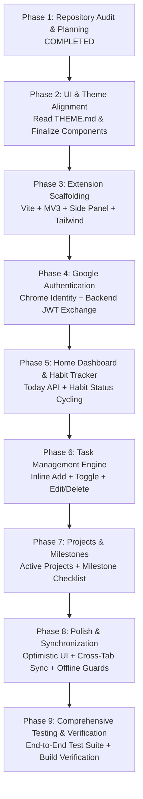

# Ascend Chrome Extension — Implementation Plan & Technical Blueprint

This plan outlines the end-to-end technical strategy for building the Ascend Chrome Extension companion, adhering strictly to the user's constraints, UI/UX philosophy, and existing backend architecture.

---

## 1. Google Authentication Integration Plan

### 1.1 Existing Backend Authentication Audit Summary

The existing backend has two paths that produce Ascend JWTs:
1. **Spring Security OAuth2 (`oauth2Login`)**:
   - Initiated at `/oauth2/authorization/google`.
   - Relies on server-side redirect to Google, then redirect back to Spring Boot (`/login/oauth2/code/google`), and finally redirects browser to `sprout.oauth2.frontend-redirect-uri` (`http://localhost:5173/oauth2/callback?token=...`).
2. **Token Exchange Endpoint (`AuthController.java: /api/auth/register-oauth`)**:
   - Accepts an `Authorization: Bearer <token>` header.
   - Currently decodes the token with an ES256 NimbusJwtDecoder against Supabase JWKS, retrieves `email` and `name`, and calls `AuthService.registerOAuth(new RegisterOAuthRequest(email, name, username))`.
   - `AuthService.registerOAuth()` finds or creates the user in the PostgreSQL database and returns an `AuthResponse` containing a 24-hour Ascend JWT (`token`) and the `UserResponse` object (`id`, `name`, `email`, `currentStreak`, etc.).

### 1.2 Chrome Extension OAuth Options Evaluated

| Option | Method | How It Works | Pros | Considerations / Changes Needed |
|---|---|---|---|---|
| **Option A (Recommended)**<br>*Direct Google Token Verification Endpoint* | `chrome.identity.launchWebAuthFlow` or `chrome.identity.getAuthToken` + `POST /api/auth/google` | 1. Extension obtains a Google ID Token or Access Token via `chrome.identity`.<br>2. Extension calls backend `POST /api/auth/google` with `{ "idToken": "..." }`.<br>3. Backend verifies token using Google token verification (or Google's tokeninfo endpoint), extracts `email` and `name`, calls `googleOAuth2Service.findOrCreateUser()`, and returns `{ token, user }`. | • Rock-solid security.<br>• Works cleanly with standard Chrome OAuth.<br>• Reuses existing `GoogleOAuth2Service`.<br>• Zero brittle URL fragment parsing. | Requires adding one clean REST controller endpoint in Spring Boot: `POST /api/auth/google`. |
| **Option B**<br>*Web Auth Flow with Existing Spring Security OAuth2* | `chrome.identity.launchWebAuthFlow` pointing to `/oauth2/authorization/google` | 1. Extension opens backend Google OAuth URL with `redirect_uri=https://<extension-id>.chromiumapp.org/`.<br>2. Backend completes OAuth with Google and redirects to the Chromium redirect URI with `?token=<jwt>`.<br>3. Extension captures redirect and extracts token. | • No new token decoder needed on backend.<br>• Reuses Spring Security OAuth2 filter. | Requires `OAuth2AuthenticationSuccessHandler` to accept a dynamic redirect URI parameter or allow the Chrome extension callback domain. |
| **Option C**<br>*Supabase OAuth via `launchWebAuthFlow`* | `chrome.identity.launchWebAuthFlow` pointing to Supabase Google OAuth URL | 1. Extension opens Supabase OAuth URL with redirect to `chrome.identity.getRedirectURL()`.<br>2. Captures `#access_token=...` from Supabase.<br>3. Calls existing `POST /api/auth/register-oauth` with `Bearer <supabase_token>`. | • Requires **zero backend changes** (100% existing backend code).<br>• Uses already tested Supabase JWKS decoder. | Depends on active Supabase credentials configured in backend. |

### 1.3 Recommended Strategy: Option A / C Hybrid

- For seamless local development and production robustness, we recommend supporting Google identity verification on the backend:
  - If Supabase OAuth is active in the environment: Call `POST /api/auth/register-oauth` using the Supabase OAuth redirect flow (Zero backend changes!).
  - If native Google OAuth is preferred: Add a lightweight `POST /api/auth/google` in `AuthController.java` that accepts the Google ID token and calls `googleOAuth2Service.findOrCreateUser()`.
- **Token Persistence & Lifecycle**:
  - Store Ascend JWT in `chrome.storage.local.set({ ascend_token, ascend_user })`.
  - Attach `Authorization: Bearer <ascend_token>` to every Axios request.
  - On `401 Unauthorized` response: Remove token and user from `chrome.storage.local`, update React state, and present the Google Sign-In button.
  - On Sign Out: Remove token, clear in-memory state, reset UI to LoginView.

---

## 2. Theme Integration Plan (Light & Dark Modes)

### 2.1 Visual Source of Truth

The user indicated that `THEME.md` will be provided as the primary source of truth for the extension's visual design.

In our repository audit, we identified the existing token foundation in `sprout/frontend/src/index.css` and `home.css`:
- **Light Theme**:
  - Background: `--bg: #f5f0e8` (warm sepia/cream)
  - Card/Surface: `--surface: #fffdf7`
  - Secondary Surface: `--surface-2: #edeae0`
  - Border: `--border: #d8d0c0`
  - Text: `--text: #2a2218`
  - Text Muted: `--text-muted: #9a9080`
  - Accent: `--accent: #c05a20` (or `#d95a2b` warm terracotta orange)
  - Green / Success: `--green: #437830`
  - Red / Missed: `--red: #b03050`
- **Dark Theme**:
  - Background: `--bg: #241b29` (deep warm plum/dark charcoal)
  - Card/Surface: `--surface: #332638`
  - Secondary Surface: `--surface-2: #3d2e44`
  - Border: `--border: #4a3a52`
  - Text: `--text: #f6ecf4`
  - Text Muted: `--text-muted: #c0a9c2`
  - Accent: `--accent: #e07fc0`
  - Green / Success: `--green: #7ec99a`
  - Red / Missed: `--red: #f07090`

### 2.2 Theme Implementation Strategy

1. **CSS Variable Design Tokens**:
   - Centralize all design tokens into `src/styles/theme.css`.
   - Use CSS custom properties (`var(--bg)`, `var(--surface)`, `var(--border)`, `var(--text)`, `var(--accent)`) throughout all components.
   - Zero hardcoded hex colors inside component JSX files.
2. **Theme State & Persistence**:
   - Supported modes: `"light"`, `"dark"`, and `"system"`.
   - Persist user choice in `chrome.storage.local` under `ascend_theme`.
   - Apply class (`.dark`) on document root (`document.documentElement`).
   - Listen for OS-level changes via `window.matchMedia('(prefers-color-scheme: dark)')` when `"system"` is active.
3. **Contrast & Readability Assurance**:
   - Ensure WCAG AA contrast ratio (> 4.5:1) for all typography against `--surface` and `--bg`.
   - Distinct interactive hover and focus rings with outline offset.
   - When the user provides `THEME.md`, any additional or refined tokens will be dropped into `theme.css` without modifying component logic.

---

## 3. Dashboard-First UI & Navigation Architecture

> **Guiding Principle:** The Home dashboard is the primary workspace of the extension. Tasks and habits are managed directly on Home without navigation pages. Separate views are introduced only for expanded milestone detail or habit definition settings.

### 3.1 Proposed Extension UI Wireframe & Layout

```
┌────────────────────────────────────────────────────────┐
│  ASCEND               Thu, Nov 7       [🌓] [User 👤] │  <-- Compact Header
├────────────────────────────────────────────────────────┤
│  TODAY'S MOMENTUM                                      │
│  ┌──────────────────────────────────────────────────┐  │
│  │   ╭─────╮     Day 14 of 75                       │  │
│  │  (  75%  )    3-day streak 🔥                     │  │  <-- TodayProgressCard
│  │   ╰─────╯     6 of 8 completed today             │  │
│  └──────────────────────────────────────────────────┘  │
├────────────────────────────────────────────────────────┤
│  DAILY HABITS (Tap to cycle status)                    │
│  ┌──────────┐ ┌──────────┐ ┌──────────┐ ┌──────────┐   │
│  │ 💧 Water │ │ 🏋️ Gym   │ │ 📖 Read  │ │ 🧘 Medit │   │  <-- HabitQuickStrip
│  │  [DONE]  │ │  [DONE]  │ │   [GO]   │ │  [SKIP]  │   │      (1-click cycle)
│  └──────────┘ └──────────┘ └──────────┘ └──────────┘   │
├────────────────────────────────────────────────────────┤
│  TASKS                               [All | Open | Done]│
│  ┌──────────────────────────────────────────────────┐  │
│  │ [ + Add a task for today...               Enter ]│  │  <-- InlineTaskInput
│  └──────────────────────────────────────────────────┘  │
│                                                        │
│  [ ] Review pull request           [HIGH]   Today  ⋮   │
│  [✓] Deploy backend staging        [MED]    Today  ⋮   │  <-- Direct Toggle &
│  [ ] 📌 Project Milestone item     [CHECK]  Today  ⋮   │      Contextual Edit
│                                                        │
├────────────────────────────────────────────────────────┤
│  ACTIVE PROJECTS                                       │
│  ┌──────────────────────────────────────────────────┐  │
│  │ 📁 Mobile Redesign                   65% ━━━━━   │  │  <-- ProjectSummaryRow
│  │    Next: Complete user interview checklist  >   │  │      (Click expands)
│  └──────────────────────────────────────────────────┘  │
└────────────────────────────────────────────────────────┘
```

### 3.2 Detailed Interaction Specifications

1. **Direct Habit Interactions**:
   - Habit icons displayed in a horizontal scrollable or wrapped row.
   - Clicking a habit chip immediately advances its status: `PENDING` -> `COMPLETED` -> `MISSED` -> `SKIPPED` -> `COMPLETED`.
   - Instant optimistic UI update with background call to `PUT /api/habits/{id}/logs`.
   - Today's progress ring updates in real-time with smooth CSS transition.
2. **Inline Task Creation**:
   - Prominent text input: *"Add a task for today..."*.
   - Pressing **Enter** immediately creates the task via `POST /api/todos/quick` (`dueDate = today`).
   - An optional expander icon reveals Priority selector (High, Med, Low) and custom Due Date picker for non-today tasks.
   - Input clears automatically and focus remains ready for the next task.
3. **Task Completion & Contextual Management**:
   - Single click on circular checkbox calls `PATCH /api/todos/{id}/toggle`.
   - Completed tasks strike through with muted styling.
   - Hover reveals a compact `⋮` kebab menu with **Edit** (opens lightweight inline popover) and **Delete** (`DELETE /api/todos/{id}`).
4. **Milestone Integration**:
   - Milestone checklist items due today appear directly inside the task list with a distinct `📌 MILESTONE` badge.
   - Toggling the item calls `PATCH /api/todos/checklist/{projectId}/{milestoneId}/{itemId}/toggle`.
5. **Project Milestone Inspection (Secondary View)**:
   - Clicking a project card on the dashboard opens a slide-over/modal view showing all milestones for that project, their checklist items, and an "Add milestone" button.
   - Back button returns instantly to the Home dashboard with no lost state.

---

## 4. Phase-by-Phase Implementation Roadmap



### Phase Details & Deliverables

#### **Phase 1: Repository Audit & Planning (Current)**
- **Objective:** Deeply inspect the codebase, verify database schemas, map REST APIs, determine authentication flows, and produce architectural documentation.
- **Deliverables:** `EXISTING_ARCHITECTURE.md`, `EXTENSION_ARCHITECTURE.md`, `API_MAPPING.md`, `IMPLEMENTATION_PLAN.md`.
- **Status:** Complete. Awaiting user approval.

#### **Phase 2: UI & Theme Alignment**
- **Objective:** Ingest `THEME.md` upon provision, define CSS design tokens, build the design system specification, and establish the component contract.
- **Deliverables:** `theme.css` tokens, Typography scales, Component state definitions (default, hover, focus, disabled).

#### **Phase 3: Extension Scaffolding & Build Setup**
- **Objective:** Create the React 18 + Vite application in `Chrome-Extension-Ascend`, configure Manifest V3, configure Side Panel with `openPanelOnActionClick`, set up Tailwind CSS and Lucide icons.
- **Deliverables:** `manifest.json`, `vite.config.js`, `package.json`, `sidepanel.html`, `service-worker.js`.

#### **Phase 4: Google Authentication Implementation**
- **Objective:** Wire Google Sign-In via `chrome.identity`, integrate with the backend's token exchange, securely store the Ascend JWT in `chrome.storage.local`, build `AuthContext`, and verify authenticated requests.
- **Deliverables:** `src/api/auth.js`, `src/context/AuthContext.jsx`, `src/pages/LoginView.jsx`.

#### **Phase 5: Habit Tracker & Today Dashboard**
- **Objective:** Implement `TodayProgressCard` (SVG ring, streak count, day badge) and `HabitQuickStrip` (direct 1-click status cycling). Test synchronization between extension and web app.
- **Deliverables:** `src/components/dashboard/TodayProgressCard.jsx`, `src/components/dashboard/HabitQuickStrip.jsx`, `src/api/days.js`, `src/api/habits.js`.

#### **Phase 6: Inline Task Management**
- **Objective:** Implement `InlineTaskInput` directly on the Home dashboard, task row rendering, priority badges, direct completion toggle, and contextual edit/delete.
- **Deliverables:** `src/components/dashboard/InlineTaskInput.jsx`, `src/components/dashboard/TaskRow.jsx`, `src/api/todos.js`.

#### **Phase 7: Projects & Milestones**
- **Objective:** Implement active project cards on dashboard and secondary project milestone view for checklist item management.
- **Deliverables:** `src/components/dashboard/ProjectSummaryRow.jsx`, `src/pages/ProjectsView.jsx`, `src/api/projects.js`.

#### **Phase 8: Theme Switcher & Data Synchronization**
- **Objective:** Implement Light/Dark/System theme switching with zero lag, optimistic UI state updates, and error toast alerts.
- **Deliverables:** `src/context/ThemeContext.jsx`, `src/components/layout/ThemeToggle.jsx`.

#### **Phase 9: Comprehensive Testing & Verification**
- **Objective:** Run full end-to-end testing (cross-platform sync between web app and extension, token expiration handling, production `vite build`, loading unpacked in Chrome).
- **Deliverables:** `SETUP_AND_RUN.md`, `CHANGELOG.md`, `IMPLEMENTATION_STATUS.md`.

---

## 5. Potential Technical Risks & Missing Requirements

1. **`THEME.md` File Delivery**:
   - The user specified that `THEME.md` will be provided and must be understood before implementing UI.
   - *Mitigation:* We have extracted existing tokens from `index.css` for Phase 1 planning. We will immediately review `THEME.md` as soon as the user shares it in Phase 2.
2. **CORS Headers on Spring Boot Backend**:
   - The backend `SecurityConfig.java` currently allows `${sprout.cors.allowed-origin:http://localhost:5173}`.
   - When the extension makes `fetch`/`axios` requests, its origin is `chrome-extension://<extension_id>`.
   - *Mitigation:* Manifest V3 background service workers and extension side panels can make direct requests if host permissions (`http://localhost:8080/*`) are declared in `manifest.json`. If standard CORS blocking occurs in browser side panels, we will update `SecurityConfig.java` CORS configuration to allow `chrome-extension://*` origins or route via the service worker.
3. **Google OAuth Client ID & Redirect URI**:
   - Google OAuth requires the redirect URI (e.g. `https://<extension-id>.chromiumapp.org/` or `http://localhost:8080/login/oauth2/code/google`) to be registered in Google Cloud Console.
   - *Mitigation:* We document exact instructions for adding the Chrome Extension redirect URI to the user's Google Cloud project credentials.
4. **Single Source of Truth Verification**:
   - Changes in the extension must reflect in the web application and vice versa.
   - *Mitigation:* Because both clients share the identical PostgreSQL database through the same Spring Boot REST APIs, data is synchronized at the database level. When an item is marked done in the extension, refreshing or navigating in the web app immediately reveals the updated state.
